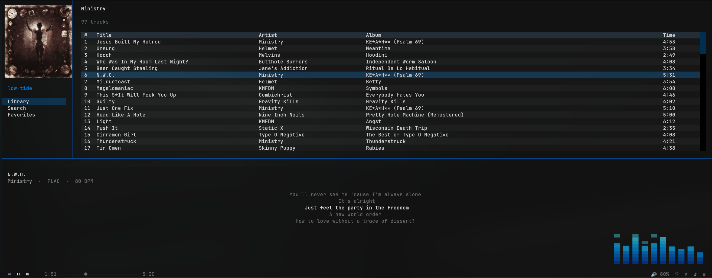
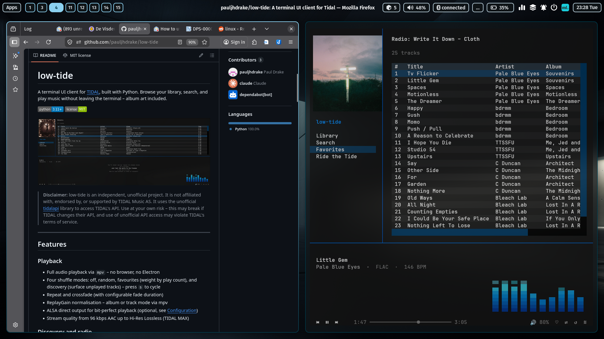
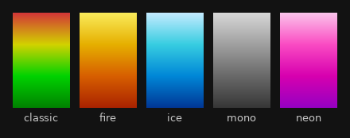

# low-tide

A terminal UI client for [TIDAL](https://tidal.com), built with Python. Browse your library, search, and play music without leaving the terminal, album art included.






> **Disclaimer:** low-tide is an independent, unofficial project. It is not affiliated with, endorsed by, or supported by TIDAL Music AS. It uses the unofficial [tidalapi](https://github.com/tamland/python-tidal) library to access TIDAL's API. Use at your own risk. It may break if TIDAL changes their API, and using unofficial API access may violate TIDAL's terms of service.

---

## Recent Updates

**Orbit** – a new way to explore similar artists. Pick Orbit from the sidebar (or press `O` on any artist page) and you get one artist in the middle with their closest Last.fm matches around them. The more similar an artist is, the nearer they sit, and anyone you've already played is highlighted. Arrow keys move around the ring, Enter puts the selected artist in the middle, and Backspace steps back along your trail, so you can wander out from something familiar one hop at a time. `o` opens an artist's page and `R` starts a radio from them. The Adventure Dial works here too, and Orbit needs Last.fm to be configured.

**Local playback, MPRIS controls and other fixes** – local files play again, after the hi-res change broke them, and they now survive a restart in the saved queue. MPRIS controls behave properly: `Pause` no longer resumes playback when already paused, `Next` respects favourites and discovery shuffle, and volume, shuffle and repeat set from your desktop or `playerctl` now actually apply. Tracks you've already favourited show ♥, and `l` can unlove them. Last.fm requests run in the background so a slow connection no longer freezes the UI. Your saved TIDAL login is now only readable by you, and running two instances at once no longer breaks playback in either. Album art also displays cleanly in Konsole and other Sixel terminals, without grey bars or leftover fragments around it. Thanks to @Ritsj for both PRs.

**MPRIS fixes for strict media clients** – low-tide now works with stricter MPRIS clients such as Quickshell/Caelestia, not just playerctl. The D-Bus service was silently failing to register because getter-only properties were declared writable, and even once visible it was missing root-interface properties (`Fullscreen`, `CanSetFullscreen`, `DesktopEntry`) that strict clients require. Live title, artist, artwork, duration and playback status now reach clients too, since property-change signals were being emitted through a nonexistent API and dropped. Seeking also follows MPRIS semantics properly: relative `Seek` and absolute progress-bar `SetPosition` both work. Thanks to @JDY-exe for the detailed report and diagnosis.

**Hi-res playback** – tracks available in Hi-Res Lossless (FLAC up to 24-bit / 192 kHz) now play at full resolution. TIDAL delivers hi-res as a segmented DASH stream rather than a single file, which the previous stream fetch couldn't read, so hi-res tracks silently failed to play. low-tide now decodes the DASH manifest and hands it to mpv directly. Tracks that offer hi-res show a small ᴴᴵᴿᴱˢ badge in track lists, and if a quality tier isn't covered by your subscription, playback falls back to the next tier down instead of failing.

**Now-playing sync fix** – if a stream URL failed to load mid-queue (for example under rate limiting), the now-playing bar, scrobbler and queue highlight could drift out of sync with the track actually playing. mpv's playlist position is now mapped explicitly to the queue, so the display always matches the audio, and an unloadable track is skipped cleanly rather than shifting everything after it.

**Rate limiting improvements** – switching between long playlists no longer triggers rate-limit errors from TIDAL's API. This came from two changes:
- **Windowed URL loading** – only the next 8 stream URLs are fetched at a time rather than the entire playlist upfront. When you switch playlists, far fewer wasted requests are made before the old load is cancelled. URLs for upcoming tracks are fetched in the background as playback advances.
- **Global throttle + auto-retry** – all API calls now share a single rate limiter (0.3 s minimum between requests). If a rate-limit response is received anyway, the request is retried automatically with the server's suggested back-off delay rather than surfacing an error.

**Configurable background colour** – set `"background"` in `config.json` to any CSS colour string to override the app background. The default (`"ansi_default"`) continues to use your terminal's background and respects transparency settings.

---

## Features

### Playback
- Full audio playback via `mpv`, no browser or Electron
- Gapless playback, with tracks pre-buffered so there's no gap between them
- Four shuffle modes: off, random, favourites (weight by play count), and discovery (surface unplayed tracks). Press `s` to cycle
- Repeat and crossfade (with configurable fade duration)
- ReplayGain normalisation via mpv, in album or track mode
- ALSA direct output for bit-perfect playback (optional, see [Configuration](#configuration))
- Stream quality from 96 kbps AAC up to Hi-Res Lossless (TIDAL MAX)

### Discovery and radio
- **Track radio** – press `R` on any track to build a 25-track radio seeded from that track using Last.fm similarity data, artist tag matching, and your play history
- **Genre Radio** – browse TIDAL's curated genre catalogue or type any Last.fm tag (e.g. `shoegaze`, `drum and bass`) to build a genre playlist
- **Ride the Tide** – personalised recommendations from the sidebar, built from your overall listening history across TIDAL, Last.fm and Spotify, with no seed track needed
- **Adventure Dial** – press `D` in any radio or genre screen to set how far recommendations stray from what you already know:
  - *Essential* – close matches only, using a high similarity threshold and lighter novelty weighting
  - *Balanced* – the default, with a moderate pool of similar artists and standard novelty weighting
  - *Adventurous* – a wider pool of similar artists and stronger novelty weighting, so more of what comes up is stuff you've rarely or never heard
- **Orbit** – a map of similar artists around one artist in the middle, with nearer meaning more similar. Enter re-centres on the selected artist so you can walk outward hop by hop; `o` opens their page and `R` starts a radio. Needs Last.fm
- All radio modes work without Last.fm using play count data alone, with a prompt to configure it for richer results

### Library and browsing
- Browse playlists, mixes, and TIDAL's For You recommendations
- Favourites browser with separate tabs for saved tracks, albums, and artists, showing your whole library rather than the first 50
- Sort favourite albums by name, date added, release date, or artist – press `S` to cycle
- Search tracks, albums, and artists
- Album and artist drill-down views with bio tab (artist description from TIDAL)
- Love / unlove tracks, synced with TIDAL favourites
- Local library: browse and play locally stored files (FLAC, MP3, OPUS, OGG, M4A); metadata read via mutagen, library cached for fast startup

### Listening Journey
- Heatmap of your Last.fm scrobble history, organised by artist (rows) and month (columns)
- Top 25 artists by total scrobbles shown; scroll left/right through time
- Press `G` to toggle between per-artist and absolute scale
- Press `Enter` on an artist to open their page; press `R` to start a radio from them
- Requires Last.fm to be configured (see [Configuration](#configuration))

### Queue
- Add tracks to the queue without interrupting playback. Press `a` on any track to add it, or `A` to add the entire album, playlist, or favourites list
- Queue persists across restarts and reopens with the queue panel visible and playback resuming where you left off

### Now playing
- Animated EQ visualiser with cava-style gravity fall, peak hold indicators, and analogue gradient colouring (toggle with `e`)
- Synced lyrics displayed in the player bar, scrolling in time with playback
- Track info: BPM, audio quality, and explicit flag
- Album art rendered inline, using the kitty graphics protocol or Sixel depending on your terminal, with a block-character fallback elsewhere

### Integrations
- **MPRIS2** – media keys, `playerctl`, and desktop now-playing panels
- **Last.fm scrobbling** – configured via `config.json` (see [Configuration](#configuration))
- **Play count tracking** – local play counts seed the favourites/discovery shuffle modes; Last.fm history synced automatically at startup if configured; Spotify listening history can be imported from a GDPR data export (see [Shuffle modes](#shuffle-modes))

### Interface
- Transparent UI designed for GPU-accelerated terminals
- Queue panel toggle
- Keyboard-first with mouse click support for track selection

## Requirements

**low-tide is Linux-only.** It relies on Unix sockets for mpv IPC and D-Bus for MPRIS. macOS and Windows are not supported.

- **Python 3.11+**
- **A TIDAL subscription** (HiFi or higher recommended for lossless playback)
- **mpv** – for audio playback (must be installed separately)
- **A terminal with image support** (recommended) – the kitty graphics protocol (e.g. kitty) or Sixel (e.g. Konsole) shows album art at full resolution. Other terminals show a lower-resolution version drawn with coloured block characters

### Installing mpv

```bash
# Arch / CachyOS
sudo pacman -S mpv

# Ubuntu / Debian
sudo apt install mpv
```

## Installation

```bash
git clone https://github.com/pauljhdrake/low-tide.git
cd low-tide
pip install .
```

This installs all Python dependencies and adds a `low-tide` command to your PATH. A virtual environment is recommended:

```bash
python -m venv .venv
source .venv/bin/activate        # bash/zsh
source .venv/bin/activate.fish   # fish
pip install .
```

For an editable install (if you want to hack on it):

```bash
pip install -e .
```

## Running

```bash
low-tide
```

On first launch you will be prompted to authenticate with TIDAL via a device-code login. Open the URL it prints in your browser and follow the prompts. Tokens are saved to `~/.config/low-tide/session.json` and reused on future launches.

## Authentication and Token Handling

low-tide uses TIDAL's OAuth 2.0 device-code flow. low-tide never sees or stores your TIDAL password. You log in directly with TIDAL in your browser.

After login, TIDAL issues an access token and a refresh token. These are stored **locally on your machine** at:

```
~/.config/low-tide/session.json
```

This file:
- is never read by anything other than low-tide on your machine
- is excluded from the repository via `.gitignore` and will never be committed
- contains no password, only the OAuth tokens issued by TIDAL
- can be revoked at any time by contacting TIDAL support or deleting the file (you will be prompted to re-authenticate on next launch)

The source code for token handling is in [`lowtide/tidal_client.py`](lowtide/tidal_client.py) if you want to inspect it.

## Keybindings

| Key | Action |
|-----|--------|
| `space` | Play / Pause |
| `n` | Next track |
| `p` | Previous track |
| `]` / `[` | Volume up / down |
| `s` | Cycle shuffle mode (off → random → favourites → discovery) |
| `S` | Cycle favourite album sort order (name → date added → release date → artist) |
| `e` | Toggle EQ visualiser |
| `r` | Toggle repeat |
| `l` | Love / unlove current track |
| `x` | Toggle crossfade |
| `R` | Start radio from focused track |
| `D` | Cycle Adventure Dial (Essential → Balanced → Adventurous) in radio / genre / Orbit screens |
| `O` | Open Orbit centred on the current artist (artist page) |
| `enter` / `backspace` | Re-centre on the selected artist / step back (Orbit) |
| `o` / `c` | Open the selected artist's page / re-centre on what's playing (Orbit) |
| `G` | Toggle heatmap scale (Listening Journey) |
| `a` | Add focused track to queue |
| `A` | Add all tracks in current view to queue |
| `q` | Toggle queue panel |
| `ctrl+s` | Go to Search |
| `ctrl+l` | Go to Library |
| `escape` | Navigate back |
| `ctrl+q` | Quit |

## Shuffle modes

Press `s` to cycle through four modes. The active mode is shown in the now-playing bar:

| Icon | Mode | Behaviour |
|------|------|-----------|
| `⇄` (dim) | Off | No shuffle |
| `⇄` (bold) | Random | Flat random order |
| `★` | Favourites | Tracks you've played more appear earlier |
| `⊕` | Discovery | Tracks you've played least (or never) appear earlier |

Shuffle modes are driven by a local play count store at `~/.config/low-tide/playcounts.json`, built from three sources:

- **Local scrobbles** – incremented automatically each time you listen past 50% of a track
- **Last.fm** – if Last.fm is configured, your all-time top tracks are synced at startup
- **Spotify import** – if you're moving from Spotify, run:

```bash
low-tide import-spotify ~/path/to/your/spotify-data/
```

To get your data: go to [spotify.com](https://spotify.com) → Account → Privacy settings → Request data download. You'll receive an email with a zip file. Extract it and pass the folder path to the command above. Only streams over 30 seconds count, matching the scrobbling threshold used elsewhere.

## Transparency

low-tide uses transparent backgrounds throughout. For the full effect with your desktop wallpaper showing through, enable background opacity in kitty:

```ini
# ~/.config/kitty/kitty.conf
background_opacity 0.85
```

## Configuration

Create `~/.config/low-tide/config.json` to override defaults:

```json
{
  "quality": "lossless"
}
```

| Key | Values | Default | Description |
|-----|--------|---------|-------------|
| `quality` | `"low"` `"high"` `"lossless"` `"max"` | `"lossless"` | Stream quality. `"max"` requires a TIDAL Max subscription. |
| `music_dir` | string or array | none | Local music directory or directories. Adds a Local section to the sidebar. e.g. `"/home/user/Music"` or `["/home/user/Music", "/mnt/nas/Music"]` |
| `replaygain` | `"album"` `"track"` `"no"` | `"album"` | ReplayGain mode. `"album"` preserves intended volume differences between tracks on the same album; `"track"` normalises every track to the same loudness. |
| `alsa_output` | `true` / `false` | `false` | Route audio directly to ALSA, bypassing PulseAudio/PipeWire. Useful for bit-perfect output. |
| `alsa_device` | string | system default | ALSA device name, e.g. `"hw:0,0"`. |
| `alsa_bit_depth` | `16` `24` `32` | `32` | Output bit depth when using ALSA. |
| `alsa_samplerate` | integer | source rate | Output sample rate when using ALSA, e.g. `192000`. |
| `crossfade` | integer | `5` | Crossfade duration in seconds when crossfade is enabled (toggle with `x`). Crossfade is off at startup regardless of this value. |
| `eq_theme` | `"classic"` `"fire"` `"ice"` `"mono"` `"neon"` | `"mono"` | Colour theme for the EQ visualiser in the now-playing bar. |
| `eq_labels` | `true` / `false` | `false` | Show frequency labels (32 Hz – 16 kHz) beneath the EQ visualiser bars. |
| `background` | CSS color string | `"ansi_default"` | App background color. `"ansi_default"` uses the terminal's default background, which respects your terminal emulator's transparency setting (e.g. `background_opacity` in kitty). Set to a hex color like `"#181825"` to disable transparency. |



To enable Last.fm scrobbling, add a `lastfm` block. Get an API key at [last.fm/api](https://www.last.fm/api/account/create). `password_hash` is the MD5 hash of your password. Generate it with `python3 -c "import hashlib; print(hashlib.md5('yourpassword'.encode()).hexdigest())"`.

```json
{
  "lastfm": {
    "api_key": "your_api_key",
    "api_secret": "your_api_secret",
    "username": "your_username",
    "password_hash": "md5_of_your_password"
  }
}
```

Example for bit-perfect TIDAL MAX output:

```json
{
  "quality": "max",
  "replaygain": "no",
  "alsa_output": true,
  "alsa_device": "hw:0,0",
  "alsa_bit_depth": 32,
  "alsa_samplerate": 192000
}
```

## Known Limitations

- **Unofficial API** – relies on [tidalapi](https://github.com/tamland/python-tidal), which may break when TIDAL updates their backend
- **mpv required** – audio playback depends on mpv being installed as a system package
- **Album art quality depends on your terminal** – full resolution needs the kitty graphics protocol or Sixel. Other terminals fall back to coloured block characters
- **No MQA/Atmos support** – stream quality depends on your subscription; format handling is delegated to mpv

## Project Structure

```
lowtide/
  main.py              # entry point
  tidal_client.py      # tidalapi wrapper
  player.py            # mpv IPC control
  scrobbler.py         # Last.fm scrobbling
  play_count_store.py  # play count persistence and weighted shuffle
  scrobble_store.py    # Last.fm scrobble history cache (used by Listening Journey)
  app.py               # app layout: sidebar, content area, queue panel
  recommender.py       # Last.fm-powered radio and Ride the Tide logic
  screens/             # library, search, playlist, album, artist, favorites, radio, genre, journey
  widgets/             # now_playing bar, track list table, album art, EQ visualiser
```

## License

MIT. See [LICENSE](LICENSE) for details.

This project is not affiliated with or endorsed by TIDAL Music AS. TIDAL is a registered trademark of TIDAL Music AS.
